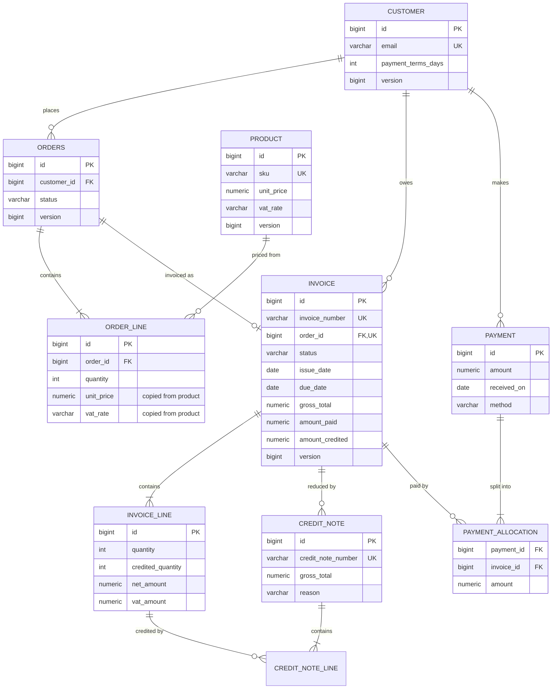
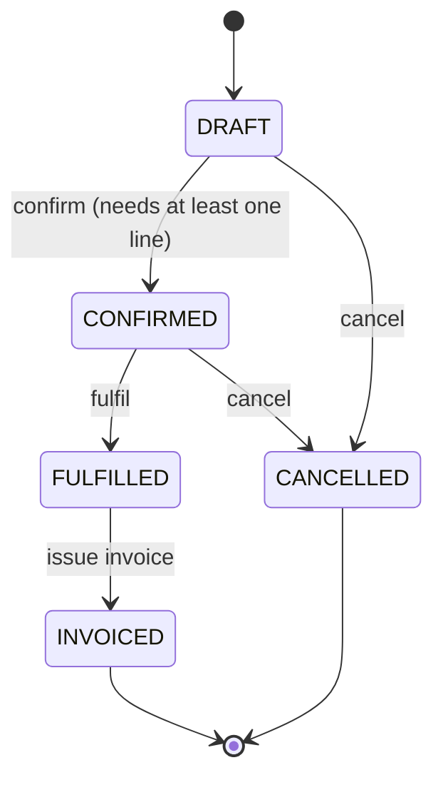
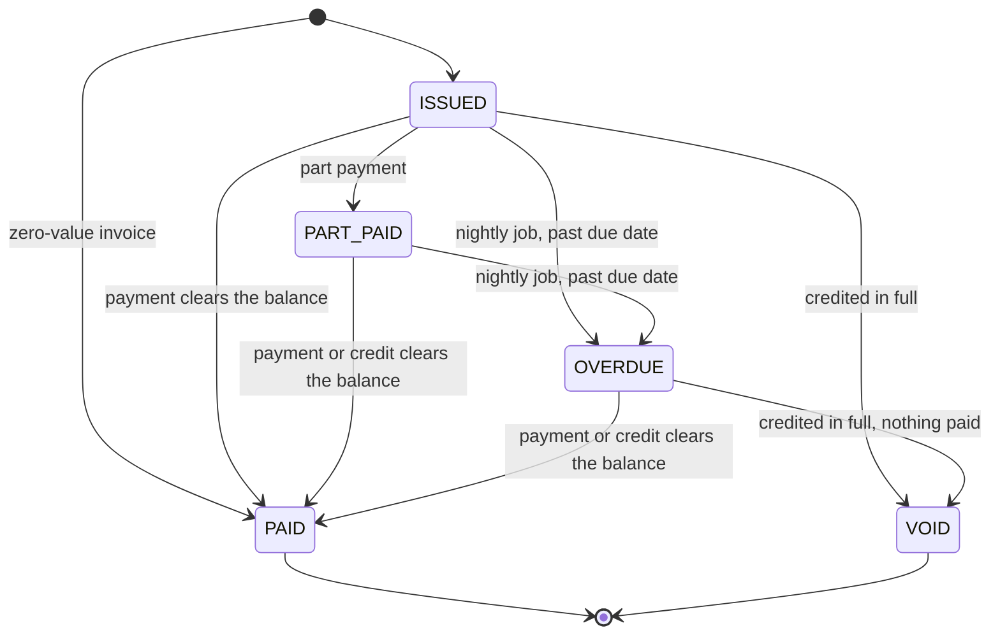

# Orders and invoicing

A Spring Boot backend for taking orders, invoicing them with UK VAT and recording payments
against the invoices. It covers the parts of an order-to-cash system that are easy to get subtly
wrong: money arithmetic and rounding, invoice numbers that must have no gaps, retries that must not
charge twice, and concurrent updates to the same balance.

Java 21, Spring Boot 3.5, Spring Data JPA (Hibernate 6), Flyway, PostgreSQL, Spring Security,
springdoc-openapi, OpenPDF. Tests use JUnit 5, AssertJ and Mockito, with integration tests against
a real PostgreSQL started from the test JVM, so no Docker is needed to run them.

## What it does

- Customers with payment terms (0 to 120 days, default 30).
- A product catalogue with prices and a UK VAT rate per product: standard 20%, reduced 5% or zero.
- Orders that move through `DRAFT -> CONFIRMED -> FULFILLED -> INVOICED`, or to `CANCELLED` before
  fulfilment. Any other move is refused with a 409. Order lines copy the product's price and VAT
  rate when they are added, so later catalogue changes do not alter an order in progress.
- Invoices issued from fulfilled orders, numbered `INV-2026-000123` with no gaps and no duplicates
  per calendar year, even when many are issued at once. Due date comes from the customer's terms.
- Invoice statuses `ISSUED`, `PART_PAID`, `PAID`, `OVERDUE` and `VOID`. A nightly job (UK time)
  marks open invoices past their due date as overdue.
- Credit notes (`CN-2026-000001`) against individual invoice lines instead of editing or deleting
  invoices. Crediting everything on an unpaid invoice makes it `VOID`.
- Payments split across a customer's invoices, either oldest due date first or with explicit
  allocations. Paying more than is owed is refused.
- Invoice PDFs and a CSV export of invoices by issue date.
- An `Idempotency-Key` header on order and payment creation, so a retried request returns the
  first response instead of creating a second order or payment.
- RFC 7807 problem details for every error, including 401 and 403.
- HTTP Basic with three roles (ADMIN, CLERK, VIEWER), an audit log of every state change,
  paginated list endpoints, OpenAPI docs and Actuator health checks.

## Domain model



Supporting tables: `document_sequence` (the per-year counters behind invoice and credit note
numbers), `idempotency_key` and `audit_event`. The schema is built by the Flyway migrations in
`src/main/resources/db/migration`; Hibernate only validates it.

### Order lifecycle



Lines can only be added or removed while the order is `DRAFT`. After fulfilment the order can no
longer be cancelled; corrections go through a credit note on the invoice.

### Invoice lifecycle



A part payment on an overdue invoice leaves it `OVERDUE`. Credits can only take the balance down
to zero, so an invoice with payments against it can be settled by a credit but never voided.

## Code layout

Packages are by feature, each holding its entities, repository, service, controller and DTOs.

```
com.mossyanwar.ordersinvoicing
  common/money      Money, VatRate, LineAmounts: the arithmetic and rounding rules
  common/error      domain exceptions and the RFC 7807 exception handler
  common/csv        small CSV writer with formula-injection protection
  customer          customers and payment terms
  product           catalogue
  order             order aggregate, lifecycle, endpoints
  invoice           invoices, credit notes, overdue job
  invoice/numbering gapless document number allocator
  invoice/document  PDF rendering and CSV export
  payment           payments, allocation rules
  admin             manual trigger for the overdue job
  idempotency       Idempotency-Key handling
  audit             audit log
  security          roles, users, 401/403 problem responses
  config            clock, scheduling, OpenAPI
```

The domain rules live on the entities and small pure classes (`Order`, `Invoice`, `InvoiceLine`,
`PaymentAllocator`, `Money`), which is what the unit tests exercise. Services load aggregates,
call those methods, write the audit event and map to response records inside one transaction.

## Running it

The Dockerfile and docker-compose.yml have not been run yet: they were written on a machine
without a Docker daemon.

### With Docker Compose

```bash
docker compose up --build
```

This starts PostgreSQL 17 and the app on port 8080. The compose file sets local-only passwords
(`admin-local`, `clerk-local`, `viewer-local`); export `APP_ADMIN_PASSWORD`, `APP_CLERK_PASSWORD`,
`APP_VIEWER_PASSWORD` and `DB_PASSWORD` to override them.

### Without Docker

Needs Java 21 and a PostgreSQL database (14 or later; developed against 17).

```bash
export DB_URL=jdbc:postgresql://localhost:5432/orders DB_USERNAME=orders DB_PASSWORD=orders
./mvnw spring-boot:run -Dspring-boot.run.profiles=local
```

The `local` profile defines the three users with the passwords above. Without it, the app expects
`APP_ADMIN_PASSWORD`, `APP_CLERK_PASSWORD` and `APP_VIEWER_PASSWORD` in the environment and refuses
to start if one is missing.

- API docs: http://localhost:8080/swagger-ui.html (OpenAPI JSON at `/v3/api-docs`)
- Health: http://localhost:8080/actuator/health (liveness and readiness under `/actuator/health/liveness` and `/readiness`)

### Tests

```bash
./mvnw verify
```

- Unit tests (`*Test`, run by Surefire): money and VAT rounding, the order state machine, invoice
  payments and overdue rules, credit note rounding, payment allocation, CSV escaping, PDF content.
- Web slice tests (`*WebTest`, `@WebMvcTest`): routing, validation, role rules and error mapping
  with the services mocked.
- Integration tests (`*IT`, run by Failsafe in the `verify` phase): the whole app on a random port,
  called over HTTP, against PostgreSQL 17 binaries started in-process by
  [zonky embedded-postgres](https://github.com/zonkyio/embedded-postgres). Each Spring test context
  gets its own database on that server.
- Concurrency tests: 80 requests fired from 8 threads at once to invoice 40 orders (each order
  requested twice) must produce exactly `INV-<year>-000001` to `000040` with no duplicates or gaps; four payments
  racing for the same balance must leave exactly one recorded; six simultaneous requests with one
  `Idempotency-Key` must create one order.

On the last run `./mvnw verify` ran 118 unit and web slice tests and 58 integration tests, all
passing, in a little over a minute. Test JVMs are capped at 512 MB (unit) and 768 MB
(integration) in `pom.xml`.

## API examples

Captured from a local run of the packaged jar against PostgreSQL 17 (embedded) on 31 July 2026,
using the `local` profile users. That run used port 18080; it is shown as 8080 here. Some response
headers and fields are trimmed.

Create two products (ADMIN) and a customer (CLERK):

```bash
curl -u admin:admin-local -X POST localhost:8080/api/products \
  -H 'Content-Type: application/json' \
  -d '{"sku":"WID-1","name":"Widget","unitPrice":"19.99","vatRate":"STANDARD"}'
# {"id":1,"sku":"WID-1","name":"Widget","unitPrice":19.99,"vatRate":"STANDARD","active":true,"version":0}

curl -u admin:admin-local -X POST localhost:8080/api/products \
  -H 'Content-Type: application/json' \
  -d '{"sku":"BOOK-1","name":"Field guide","unitPrice":"8.00","vatRate":"ZERO"}'

curl -u clerk:clerk-local -X POST localhost:8080/api/customers \
  -H 'Content-Type: application/json' \
  -d '{"name":"Acme Ltd","email":"accounts@acme.example","billingAddress":"1 High Street, Leeds LS1 1AA","paymentTermsDays":30}'
```

Create an order. The `Idempotency-Key` header is required:

```bash
curl -i -u clerk:clerk-local -X POST localhost:8080/api/orders \
  -H 'Content-Type: application/json' -H 'Idempotency-Key: 7c1e9a52-order-1' \
  -d '{"customerId":1,"lines":[{"productId":1,"quantity":7},{"productId":2,"quantity":2}]}'
```

```
HTTP/1.1 201
Location: http://localhost:8080/api/orders/1

{"id":1,"customerId":1,"status":"DRAFT",
 "lines":[{"id":1,"sku":"WID-1","quantity":7,"unitPrice":19.99,"vatRate":"STANDARD","net":139.93,"vat":27.99,"gross":167.92},
          {"id":2,"sku":"BOOK-1","quantity":2,"unitPrice":8.00,"vatRate":"ZERO","net":16.00,"vat":0.00,"gross":16.00}],
 "netTotal":155.93,"vatTotal":27.99,"grossTotal":183.92,"version":0}
```

Sending exactly the same request again returns the stored response with
`Idempotent-Replayed: true` and creates nothing. Reusing the key with a different body:

```json
{
  "type": "https://orders-invoicing.example/problems/idempotency-key",
  "title": "Idempotency-Key reused",
  "status": 422,
  "detail": "This Idempotency-Key was already used with a different request body.",
  "instance": "/api/orders"
}
```

An illegal state change (`POST /api/orders/1/fulfil` on a draft):

```json
{
  "type": "https://orders-invoicing.example/problems/invalid-state-transition",
  "title": "Invalid state transition",
  "status": 409,
  "detail": "Order 1 cannot move from DRAFT to FULFILLED",
  "instance": "/api/orders/1/fulfil",
  "currentStatus": "DRAFT",
  "requestedStatus": "FULFILLED"
}
```

Confirm, fulfil and invoice:

```bash
curl -u clerk:clerk-local -X POST localhost:8080/api/orders/1/confirm
curl -u clerk:clerk-local -X POST localhost:8080/api/orders/1/fulfil
curl -u clerk:clerk-local -X POST localhost:8080/api/orders/1/invoice
```

```
{"id":1,"invoiceNumber":"INV-2026-000001","orderId":1,"status":"ISSUED",
 "issueDate":"2026-07-31","dueDate":"2026-08-30","paymentTermsDays":30,
 "vatBreakdown":[{"rate":"STANDARD","net":139.93,"vat":27.99},{"rate":"ZERO","net":16.00,"vat":0.00}],
 "netTotal":155.93,"vatTotal":27.99,"grossTotal":183.92,
 "amountPaid":0.00,"amountCredited":0.00,"outstanding":183.92,"creditNotes":[],"version":0, ...}
```

Record a payment. With no `allocations` it pays the customer's invoices oldest due date first:

```bash
curl -u clerk:clerk-local -X POST localhost:8080/api/payments \
  -H 'Content-Type: application/json' -H 'Idempotency-Key: pay-2026-07-31-001' \
  -d '{"customerId":1,"amount":"100.00","receivedOn":"2026-07-31","method":"BANK_TRANSFER","reference":"BACS ACME 4471"}'
# {"id":1,"customerId":1,"amount":100.00,...,"allocations":[{"invoiceId":1,"invoiceNumber":"INV-2026-000001","amount":100.00}]}
```

The invoice is now `PART_PAID` with 83.92 outstanding. Trying to pay 90.00:

```json
{
  "type": "https://orders-invoicing.example/problems/business-rule",
  "title": "Business rule violated",
  "status": 422,
  "detail": "Payment of 90.00 is more than the 83.92 owed across the customer's open invoices",
  "instance": "/api/payments"
}
```

Credit one returned book (ADMIN):

```bash
curl -u admin:admin-local -X POST localhost:8080/api/invoices/1/credit-notes \
  -H 'Content-Type: application/json' \
  -d '{"reason":"one field guide returned damaged","lines":[{"invoiceLineId":2,"quantity":1}]}'
# {"id":1,"creditNoteNumber":"CN-2026-000001","invoiceNumber":"INV-2026-000001",
#  "netTotal":8.00,"vatTotal":0.00,"grossTotal":8.00,"invoiceStatus":"PART_PAID","invoiceOutstanding":75.92, ...}
```

Leaving out `lines` credits everything not yet credited.

Documents (any role):

```bash
curl -u viewer:viewer-local -o INV-2026-000001.pdf localhost:8080/api/invoices/1/pdf
curl -u viewer:viewer-local 'localhost:8080/api/invoices/export.csv?from=2026-07-01&to=2026-07-31'
```

```
invoice_number,issue_date,due_date,customer_id,customer_name,status,net_total,vat_total,gross_total,amount_paid,amount_credited,outstanding
INV-2026-000001,2026-07-31,2026-08-30,1,Acme Ltd,PART_PAID,155.93,27.99,183.92,100.00,8.00,75.92
```

Audit trail for the invoice (ADMIN only):

```bash
curl -u admin:admin-local 'localhost:8080/api/audit-events?entityType=INVOICE&entityId=1'
```

```
{"content":[
  {"actor":"clerk","action":"ISSUED","toStatus":"ISSUED","detail":"INV-2026-000001 for 183.92, due 2026-08-30"},
  {"actor":"clerk","action":"PAYMENT_APPLIED","fromStatus":"ISSUED","toStatus":"PART_PAID","detail":"100.00 applied, 83.92 outstanding"},
  {"actor":"admin","action":"CREDITED","fromStatus":"PART_PAID","toStatus":"PART_PAID","detail":"CN-2026-000001 for 8.00: one field guide returned damaged"}],
 "page":0,"size":50,"totalElements":3,"totalPages":1}
```

A VIEWER trying to create an order gets a 403 problem; a request without credentials gets a 401
with `WWW-Authenticate: Basic realm="orders-invoicing"`.

### Endpoints

| Method | Path | Role |
|---|---|---|
| GET | `/api/customers`, `/api/customers/{id}` | VIEWER |
| POST, PUT | `/api/customers`, `/api/customers/{id}` | CLERK |
| GET | `/api/products?includeInactive=`, `/api/products/{id}` | VIEWER |
| POST, PUT | `/api/products`, `/api/products/{id}` | ADMIN |
| GET | `/api/orders?status=&customerId=`, `/api/orders/{id}` | VIEWER |
| POST | `/api/orders` (Idempotency-Key) | CLERK |
| POST, DELETE | `/api/orders/{id}/lines`, `/api/orders/{id}/lines/{lineId}` | CLERK |
| POST | `/api/orders/{id}/confirm`, `/fulfil`, `/cancel` | CLERK |
| POST | `/api/orders/{id}/invoice` | CLERK |
| GET | `/api/invoices?status=&customerId=`, `/api/invoices/{id}` | VIEWER |
| GET | `/api/invoices/{id}/pdf`, `/api/invoices/export.csv?from=&to=` | VIEWER |
| POST | `/api/invoices/{id}/credit-notes` | ADMIN |
| GET | `/api/invoices/{id}/credit-notes/{noteId}` | VIEWER |
| GET | `/api/payments?customerId=`, `/api/payments/{id}` | VIEWER |
| POST | `/api/payments` (Idempotency-Key) | CLERK |
| GET | `/api/audit-events?entityType=&entityId=` | ADMIN |
| POST | `/api/admin/jobs/mark-overdue` | ADMIN |

ADMIN includes CLERK, and CLERK includes VIEWER. List endpoints take `page`, `size` (max 100) and
`sort`.

## Design decisions

### Money

All amounts are a `Money` record wrapping a `BigDecimal` at exactly two decimal places, stored as
`numeric(12,2)`. There is no `double` anywhere in the money path. The constructor rejects a value
with more than two decimal places instead of rounding it, so every rounding in the system is an
explicit call to `Money.rounded` or `Money.percentage`, and request validation (`@Digits(fraction = 2)`)
turns `10.001` into a 400. Amounts are serialised as JSON numbers with two decimals (`8.00`).
Only pounds sterling is supported.

### Rounding

VAT is calculated per line on the line's net amount (unit price x quantity) and rounded half-up to
the nearest penny. Invoice totals are plain sums of the rounded line figures, so the VAT total
always equals the sum of the lines, and the PDF shows net and VAT per rate. HMRC's VAT guidance (VAT
Notice 700) describes both line-level and invoice-level calculation; line level was chosen because
each line can then be checked on its own.

Credit notes have to give back exactly what was charged. Crediting a line one unit at a time and
rounding each credit separately drifts: five one-unit credits of a 0.10 item at 5% would each round
0.005 up to 0.01 and refund 0.05 of VAT on a line that charged 0.03. Instead the VAT for a credit
is `vat(all units credited so far) - vat(units credited before)`, so the credits on a line always
add up to exactly its VAT. `CreditNoteTest` covers this case.

### Gapless invoice numbers

UK VAT invoices need a unique number that follows on from the previous one, and gaps in the
sequence invite questions in an audit. A PostgreSQL
sequence is fast but not transactional: a rolled-back insert still uses up its number. So each
series has a counter row per year in `document_sequence`, incremented with

```sql
update document_sequence set last_value = last_value + 1
where series = ? and doc_year = ? returning last_value
```

inside the same transaction that saves the invoice. The `UPDATE` takes a row lock until commit,
so concurrent issuers queue on it and get consecutive numbers, and if the invoice fails to save
the increment rolls back with it. The allocator is `@Transactional(propagation = MANDATORY)` so it
cannot be called outside that transaction by mistake. The first invoice of a year creates the row
with `insert ... on conflict do nothing`.

The cost is that invoice issuing is serialised per year. To keep the lock short the number is
taken last, after validation. The order row is also locked (`select ... for update`) at the start
of issuing, so a second request for the same order waits and then sees it is already invoiced
rather than taking a number it would have to give back. A unique constraint on
`invoice.order_id` and on `invoice_number` is the backstop.

### Idempotency

`POST /api/orders` and `POST /api/payments` require an `Idempotency-Key` header, following the IETF
httpapi Idempotency-Key draft. The key is scoped to the operation and the authenticated user.

1. The key is claimed by inserting a row (`on conflict do nothing`) in its own committed
   transaction. Only one request can claim a key.
2. The order or payment is created, and the response status, body and `Location` are stored on that
   row in the same transaction as the business change. There is never an order without a stored
   response or the other way round.
3. If the request fails, the claim is deleted so the client can retry with the same key.

A later request with the same key gets the stored response replayed (with
`Idempotent-Replayed: true`) if its body hashes the same, 422 if the body differs, and 409 if the
first request is still running. Keys older than 24 hours are deleted hourly.

### Locking and transactions

- Customers, products, orders and invoices carry a JPA `@Version`. Two payments landing on one
  invoice at the same moment both read version N; the first to commit wins and the second's update
  matches no row, so it rolls back completely and the client gets a 409 asking it to retry. Most
  writes do not collide, so optimistic locking avoids holding database locks during the request.
- Pessimistic locks are used in the two places where waiting is the right answer: the number
  counter and invoicing an order.
- `PUT` on customers and products takes the `version` the client last saw and returns 409 if it is
  stale, so a user cannot overwrite a change they never saw.
- `hibernate.order_updates` writes updates in primary key order, so two transactions touching the
  same set of invoices lock them in the same order and do not deadlock.
- Transactions are at the service layer; read methods are `readOnly`. Open-session-in-view is off,
  so responses are mapped inside the transaction and lazy loading cannot leak into the web layer.
- The overdue job updates each invoice in its own short transaction, so one invoice that changes
  mid-run is skipped and retried the next night without failing the whole batch.

### Errors

Every error is an RFC 7807 problem detail (`application/problem+json`; the RFC is now RFC 9457)
with a stable `type` URI: validation errors list each field, state machine errors include the
current and requested status, database constraint messages are logged rather than returned, and
401/403 from the security filter chain use the same shape.

### Security and audit

HTTP Basic, stateless, with in-memory users whose passwords come from the environment and are
hashed with BCrypt at startup. CSRF protection is off because there are no cookies or sessions.
Roles are enforced on URL patterns with a role hierarchy. Every state change writes an
`audit_event` row (actor, entity, action, from and to status, detail) through a method that is
`@Transactional(propagation = MANDATORY)`, so the audit row commits or rolls back with the change.

### Scheduling and time

All business dates come from an injected `Clock` in `Europe/London`, so "today" is the UK date
even when the server runs in UTC, and tests can fix the date. The overdue job runs at 00:05 UK
time. Jobs are switched off in tests.

## Limitations

- GBP only; no exchange rates.
- No refunds or customer credit balances: a payment must be fully allocated to open invoices, and a
  credit note cannot exceed what is still owed.
- Discounts, exempt or outside-the-scope supplies, and the domestic reverse charge are not modelled.
- Users are in memory and configured by properties; there is no user management.
- With several app instances, each would run the scheduled jobs. That is harmless (marking overdue
  is idempotent) but wasteful.
- The idempotency table stores whole response bodies; fine at this scale, worth a size limit at more.
- The CSV export is written synchronously by the request thread, a page of 500 rows at a time.
- The PDF uses the standard Helvetica font, which does not cover non-Latin scripts.

## Next steps

- Replace HTTP Basic with an OAuth2 resource server validating JWTs.
- Add ShedLock (or a PostgreSQL advisory lock) so only one instance runs each job.
- Refunds and customer account balances, so overpayments can be held as credit.
- Publish invoice and payment events through a transactional outbox for downstream systems.
- Customer statements and payment reminders for overdue invoices.
- Testcontainers-based tests alongside the embedded database where Docker is available.
